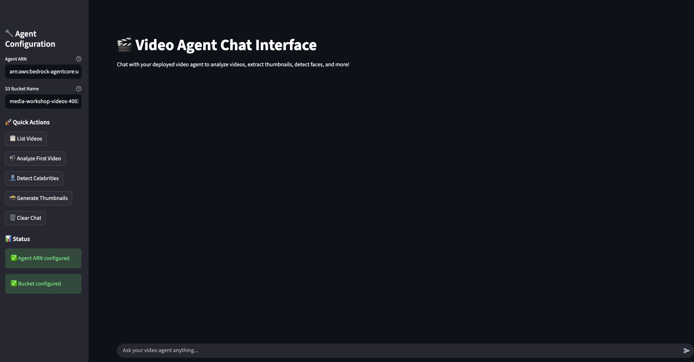

# AWS Media Video Agent 🎬

An AI-powered video analysis solution that combines AWS Bedrock AgentCore, Amazon Rekognition, and Streamlit to create an intelligent video library assistant. Upload videos to S3, chat with your AI agent to analyze content, extract thumbnails, detect faces and celebrities, and get intelligent insights about your video collection.

  

## ⚠️ Important Disclaimer

**This is a demonstration/sample project designed for learning and prototyping purposes only.**

This code is NOT production-ready. Before deploying to production, you MUST address the security considerations listed in the Security section below.

## 🎯 Features

- **🤖 AI Video Analysis**: Uses Amazon Bedrock's TwelveLabs Pegasus model for intelligent content analysis
- **📸 Thumbnail Generation**: Extract video thumbnails at specific timestamps using ffmpeg
- **👤 Face & Celebrity Detection**: Leverage Amazon Rekognition for face and celebrity recognition
- **💬 Interactive Chat Interface**: Streamlit-based web UI for natural language interaction
- **🧠 Persistent Memory**: Conversation history per session using Amazon Bedrock AgentCore Memory
- **☁️ Scalable Deployment**: Deploy on Amazon Elastic Container Service (ECS)

## 🚀 Quick Start - One-Click Deployment

### Prerequisites

- AWS CLI configured with appropriate permissions, in a [region where AgentCore is available](https://docs.aws.amazon.com/bedrock-agentcore/latest/devguide/agentcore-regions.html) (default `us-east-1`)
- Model access in Amazon Bedrock for Anthropic Claude Sonnet 4.6 and TwelveLabs Pegasus 1.5
- Node.js 20+ and npm (for the [AgentCore CLI](https://www.npmjs.com/package/@aws/agentcore), installed automatically if missing)
- [uv](https://docs.astral.sh/uv/) and Python 3.10+
- Docker running (only to build the UI image; the agent image is built in AWS CodeBuild)
- A CDK-bootstrapped account/region (`npx cdk bootstrap aws://ACCOUNT_ID/REGION` once)

> **Note:** If you previously installed the Python `bedrock-agentcore-starter-toolkit`, its `agentcore` command can shadow the new CLI on your `PATH`. The deploy script calls the npm-installed binary directly.

### Deploy Everything with One Command

```bash
./deploy-complete.sh
```

This script will automatically:

1. ✅ Deploy S3 infrastructure
2. ✅ Deploy the video agent (container with ffmpeg) and its Memory to AgentCore Runtime with the AgentCore CLI
3. ✅ Build and push Docker image to ECR
4. ✅ Deploy ECS Fargate with CloudFront and WAF
5. ✅ Configure all security settings
6. ✅ Wait for everything to be ready

**Time**: ~15-20 minutes

After deployment completes, you'll receive:

- CloudFront HTTPS URL for accessing the application
- S3 bucket name for uploading videos
- Agent ARN and other configuration details



### Upload Videos

```bash
aws s3 cp your-video.mp4 s3://YOUR-BUCKET-NAME/sample-videos/
```

### Clean Up

To remove all deployed resources:

```bash
./cleanup.sh
```

## 📁 Project Structure

```
media-video-agent/
├── README.md                           # This file
├── agentcore/                          # AgentCore CLI project
│   ├── agentcore.json                  #   Runtime, Memory, env vars, extra IAM policy
│   ├── aws-targets.json                #   Deploy target (written by deploy-complete.sh)
│   └── cdk/                            #   CDK app the CLI uses to deploy
├── app/VideoAgent/                     # Agent code (container build)
│   ├── main.py                         #   Strands agent and video tools
│   ├── memory/session.py               #   AgentCore Memory session manager
│   ├── video-agent-policy.json         #   Least-privilege policy for the agent role
│   ├── Dockerfile                      #   Agent image (Python 3.12 + ffmpeg)
│   ├── pyproject.toml / uv.lock        #   Agent dependencies
├── video_agent_ui.py                   # Streamlit web interface
├── deploy-complete.sh                  # One-click deployment script
├── cleanup.sh                          # Resource cleanup script
├── media-storage.yaml                  # CloudFormation: S3 bucket
├── ecs-fargate-ui.yaml                 # CloudFormation: ECS, CloudFront, ALB, WAF
├── Dockerfile.ui                       # Docker container for Streamlit UI
├── requirements.txt                    # UI Python dependencies (pinned)
└── LICENSE                             # MIT-0 license
```

## 🎬 Usage Examples

Once deployed, you can interact with your video agent through natural language:

- **"List all videos in my bucket"**
- **"Analyze the first video and provide a summary"**
- **"Extract thumbnails from all videos at 30 seconds"**
- **"Detect celebrities in the latest video"**
- **"What's the content of the video named 'presentation.mp4'?"**
- **"Generate thumbnails for videos in the 'movies' folder"**

## 🔧 Configuration

### UI environment variables

- `AGENT_ARN`: AgentCore Runtime ARN (required)
- `S3_BUCKET_NAME`: S3 bucket for video storage (required)
- `AWS_REGION`: AWS region (default: us-east-1)

### Agent environment variables

Set in `agentcore/agentcore.json` under `runtimes[].envVars`:

- `MODEL_ID`: Bedrock model for the agent (default `us.anthropic.claude-sonnet-4-6`)
- `PEGASUS_MODEL_ID`: video model (default `us.twelvelabs.pegasus-1-5-v1:0`)
- `MEMORY_VIDEOAGENTMEMORY_ID`: injected automatically by the AgentCore CLI

### Agent Tools

The video agent includes these built-in tools:

- `list_s3_videos()`: List and browse videos in S3
- `analyze_video_with_pegasus()`: AI-powered content analysis using TwelveLabs Pegasus
- `extract_video_thumbnail()`: Generate thumbnails at specific timestamps using ffmpeg
- `list_existing_thumbnails()`: List all previously generated thumbnails
- `get_video_duration()`: Get duration, codec, resolution and frame rate with ffprobe
- `get_video_metadata()`: Get detailed metadata for specific videos
- `detect_celebrities_in_video()`: Celebrity recognition with Amazon Rekognition
- `get_recent_celebrity_job_status()`: Check status of recent celebrity detection jobs
- `check_celebrity_recognition_job()`: Check status of specific celebrity recognition jobs
- `detect_faces_in_video()`: Face detection with Amazon Rekognition

## Security Considerations

**⚠️ This demo uses simplified security settings. Before production deployment, address these issues:**

### Known Security Issues

1. **Rekognition actions are not resource-scoped**

   - **Issue**: Rekognition video APIs do not support resource-level permissions, so the agent role allows them on `*`
   - **Fix Required**: Add condition keys or an SCP if your account policy requires it

2. **No Authentication**
   - **Issue**: Streamlit UI has no login system or user authentication
   - **Risk**: Anyone with the URL can access the application
   - **Fix Required**: Implement authentication (e.g., AWS Cognito, OAuth, or API keys)

### Current Security Features

- ✅ Least-privilege IAM: the agent role can only read/write `media-video-agent-videos-*` buckets and call the Rekognition video APIs; the UI role can only invoke this agent and read its bucket
- ✅ Temporary files use fixed local names, never paths derived from S3 keys
- ✅ S3 bucket blocks public access by default
- ✅ CloudFront enforces HTTPS
- ✅ ALB restricted to CloudFront IPs only
- ✅ AWS WAF with OWASP Top 10 protection and rate limiting
- ✅ No hardcoded credentials (uses IAM roles)

## 🛠️ Development

### Local Development Setup

1. **Clone the repository:**

```bash
git clone https://github.com/aws-samples/sample-media-video-agent-amazon-bedrock-agentcore.git
cd sample-media-video-agent-amazon-bedrock-agentcore
```

2. **Install the AgentCore CLI and CDK dependencies:**

```bash
npm install -g @aws/agentcore
(cd agentcore/cdk && npm ci)
```

3. **Run the agent locally** (needs Docker/Finch/Podman; uses your AWS credentials):

```bash
agentcore dev
```

4. **Invoke the deployed agent from the terminal:**

```bash
agentcore invoke "List the videos in bucket YOUR-BUCKET-NAME"
agentcore logs
```

### Adding New Features

To extend the agent with new capabilities:

1. **Add new tools** in `app/VideoAgent/main.py`:

```python
@tool
def your_new_tool(param: str) -> dict:
    """Your tool description"""
    # Your implementation
    return {"result": "success"}
```

2. **Register the tool** by adding it to the `TOOLS` list in `main.py`.

3. **Grant any new AWS permissions** in `app/VideoAgent/video-agent-policy.json`, then redeploy with `agentcore deploy`.

4. **Update the UI** if needed in `video_agent_ui.py`

## 🐛 Troubleshooting

### Common Issues

1. **Agent deployment fails**

   - Check IAM permissions for Bedrock AgentCore, CloudFormation and CodeBuild
   - Ensure you're in a supported region and the account is CDK-bootstrapped
   - Check the deploy log under `agentcore/.cli/logs/deploy/`

2. **UI can't connect to agent**

   - Verify the `AGENT_ARN` environment variable is correct
   - Check that the agent is in "READY" status
   - Ensure IAM roles have proper permissions

3. **Video analysis fails**

   - Confirm videos are in supported formats (MP4, MOV, AVI)
   - Check S3 bucket permissions
   - Verify Bedrock model access

4. **Thumbnail extraction fails**
   - ffmpeg is installed in `app/VideoAgent/Dockerfile`; check `agentcore logs`
   - Check video file accessibility in S3
   - Verify sufficient disk space for temporary files

### Logs and Monitoring

- **Agent Logs**: `agentcore logs`, or CloudWatch Logs under `/aws/bedrock-agentcore/runtimes/`
- **UI Logs**: ECS service logs in CloudWatch (`/ecs/media-video-agent-ecs`)
- **Infrastructure**: CloudFormation stack events

## 🤝 Contributing

See Contributing.

## 📄 License

## This project is licensed under the MIT-0 License

**Built with ❤️ for the AWS community**

Ready to analyze your videos with AI? Let's get started! 🚀
